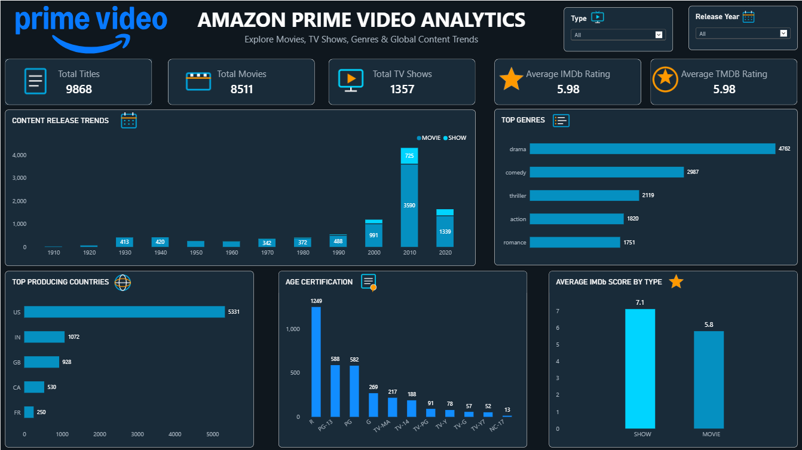

# Amazon Prime Video Analytics Dashboard

## Project Overview

This project presents an interactive Power BI dashboard that analyzes Amazon Prime Video movies and TV shows.

The dashboard provides insights into content distribution, release trends, popular genres, top-producing countries, age certifications, and IMDb ratings.

## Dashboard Preview

## Key Performance Indicators (KPIs)

- Total Titles: 9,868
- Total Movies: 8,511
- Total TV Shows: 1,357
- Average IMDb Rating: 5.98
- Average TMDB Rating: 5.98

## Dashboard Features

1. Content Release Trends – Analyzes movie and TV show releases over the years.
2. Top Genres – Identifies the most popular content genres.
3. Top Producing Countries – Shows the countries producing the most content.
4. Age Certification – Analyzes content distribution by age rating.
5. Average IMDb Score by Type – Compares ratings of movies and TV shows.

## Interactive Filters

- Content Type
- Release Year

## Tools & Technologies

- Power BI Desktop
- Power Query
- Data Cleaning
- Data Transformation
- Data Visualization

## Key Insights

- Movies represent the majority of available titles.
- Drama is the leading genre.
- The United States contributes the highest number of titles.
- TV Shows have a higher average IMDb score than Movies.

## Files Included

- `Amazon_Prime_Video_Dashboard.pbix` – Interactive Power BI dashboard.
- `dashboard.png` – Dashboard preview image.

## Conclusion

This dashboard provides an overview of Amazon Prime Video's content library and helps understand content distribution, release patterns, genre popularity, and audience ratings through interactive visualizations.
